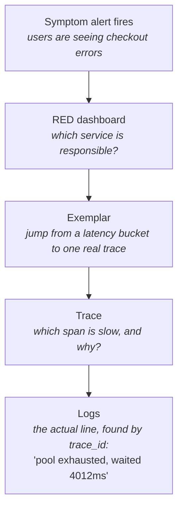
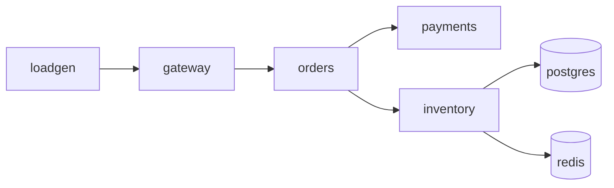
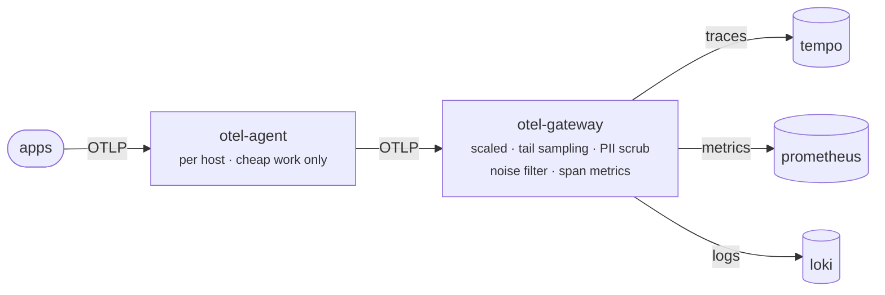

# Learning OpenTelemetry, from scratch, the DevOps way

A hands-on course built around one small application that we deliberately break, observed by a real local stack.

The guiding principle: **nothing is introduced until a problem demands it.** No tool appears in this repo before the phase where you feel its absence.

## The golden path

Everything we build exists to make this five-step drill-down possible:



If a piece of telemetry doesn't help you travel that path, it's cost without value. That is the filter for every decision here.

## The system under observation

**request path**



**telemetry path**



Four small Python services under observation — about 120 lines each, small enough to read in full, with a topology rich enough to produce every trace shape you'll meet in production: a fan-out, a database, a cache, and a real failure surface. A load generator and (from Phase 5) an alert sink keep them company.

The application code contains **zero OpenTelemetry imports**. That is deliberate and it is the Phase 0 lesson.

## Phases

| # | Phase | Stack added | Doc |
|---|---|---|---|
| 0 | Mental model + lab skeleton | collector -> stdout | [00-mental-model.md](docs/00-mental-model.md) **done** |
| 1 | Tracing | + Tempo, Grafana | [01-tracing.md](docs/01-tracing.md) **done** |
| 2 | Metrics | + Prometheus | [02-metrics.md](docs/02-metrics.md) **done** |
| 3 | Logs | + Loki | [03-logs.md](docs/03-logs.md) **done** |
| 4 | The Collector in depth | agent + gateway tiers | [04-collector.md](docs/04-collector.md) **done** |
| 5 | Symptom-based alerting | + Alertmanager | [05-alerting.md](docs/05-alerting.md) **done** |
| 6 | Break it on purpose | — | [06-field-guide.md](docs/06-field-guide.md) **done** |
| 7 | Lift to Kubernetes | kind + OTel Operator | [07-kubernetes.md](docs/07-kubernetes.md) **done** |

## How to work through this

`main` is the finished Phase 7 state. If you run it while reading Phase 0 you lose the lesson — Phase 0's whole point is reading raw OTLP *before* any UI exists.

So each phase is tagged, and **every tag is a self-consistent snapshot**: the code, the compose file and the docs are all from that moment. At `phase-0` there is genuinely no Tempo, and `docs/` contains only `00-mental-model.md`.

```bash
./tools/phase.sh 0        # tear down, check out phase-0, build, start
                          # then read docs/00-mental-model.md and do its exercises
./tools/phase.sh 1        # when you're ready to move on
...
./tools/phase.sh main     # back to the finished state
./tools/phase.sh status   # where am I, what's running
```

The script tears down volumes between phases on purpose: stale Tempo or Prometheus data from a later phase would otherwise appear as history that could not exist yet. It also stashes your `lab/.env` edits rather than carrying a chaos knob into the next phase, and at `phase-0` it sets `OTEL_ENABLED=false` so the before-and-after flip actually works — the committed value is `true`, because that file was captured after the demo had already been run.

You can run it from any phase; it reinstalls itself after each checkout, so you never need to return to `main` first.

**What each phase adds:**

```text
phase-0   app + collector → stdout            8 services, no UI at all
phase-1   + tempo, grafana                    traces
phase-2   + prometheus                        metrics
phase-3   + loki                              logs — triangle closed
phase-4   collector → agent + gateway         tail sampling, OTTL, span metrics
phase-5   + alertmanager, alertsink           SLOs and burn-rate alerts
phase-6   (no new services)                   eight failure scenarios
phase-7   + kind cluster                      the Kubernetes lift
```

**Seeing exactly what a phase changed** is often the fastest way to understand it:

```bash
git diff phase-2 phase-3 -- lab/ app/     # what did adding logs actually touch?
git diff phase-3 phase-4 -- lab/collector/
git log --oneline phase-0..phase-1
```

You'll be on a detached HEAD while on a tag — fine for reading and running. To experiment, branch: `git switch -c my-phase-3`.

## Quick start

Requires Docker Desktop to be running.

```bash
cd lab

# 1. Start with observability OFF. This is your "before" picture.
docker compose up -d --build
docker compose logs -f otel-agent        # silence. nothing is being sent.
curl -s localhost:8080/health             # the app works fine without telemetry.

# 2. Flip ONE environment variable. Change no code.
sed -i '' 's/OTEL_ENABLED=false/OTEL_ENABLED=true/' .env
docker compose up -d --force-recreate

# 3. Read the raw OTLP data model.
docker compose logs -f otel-agent
```

Step 2 is the entire argument for auto-instrumentation: a service that emitted nothing now emits full distributed traces, metrics and logs, and not one line of `app/` changed. The switch lives in `app/run.sh` and is controlled from `lab/.env` — a DevOps lever, not a developer one.

## Layout

Directories, plus the files that *are* the point of their directory.

```bash
.
├── app/                      # the services — plain business code, no OTel imports
│   ├── run.sh                # the OTEL_ENABLED switch — read this file first
│   ├── otelkit/              # the internal telemetry helper a platform team ships
│   └── gateway/ orders/ payments/ inventory/ loadgen/ alertsink/
│
├── lab/                      # the Docker Compose stack (Phases 0–6)
│   ├── docker-compose.yml
│   ├── .env                  # chaos knobs + the observability switch
│   ├── collector/
│   │   ├── agent.yaml        # agent tier — per host, cheap work only
│   │   └── gateway.yaml      # gateway tier — tail sampling, PII scrub, span metrics
│   ├── prometheus/rules/     # SLI recording rules + burn-rate alerts
│   ├── alertmanager/         # routing, grouping, inhibition
│   ├── grafana/              # provisioned datasources + generated dashboards
│   └── tempo/ loki/ postgres/
│
├── k8s/                      # the Kubernetes lift (Phase 7)
│   ├── app.yaml              # the app — note it has NO otel config
│   ├── instrumentation.yaml  # one annotation turns telemetry on
│   ├── collectors.yaml       # agent DaemonSet + gateway Deployment
│   └── rbac.yaml  kind-cluster.yaml  external-backends.yaml
│
├── chaos/scenarios.yaml      # the eight failure scenarios, declaratively
├── tools/                    # phase.sh · waterfall · golden_path · gen_dashboards · chaos
└── docs/                     # one lesson per phase, 00 through 07
```

## Where to look

| | |
|---|---|
| Grafana | <http://localhost:3000> (anonymous admin, lab only) |
| Prometheus | <http://localhost:9090> · [cardinality](http://localhost:9090/tsdb-status) |
| Tempo API | <http://localhost:3200> |
| Loki API | <http://localhost:3100> |
| Alertmanager | <http://localhost:9093> |
| Alert sink | <http://localhost:8081/alerts> · `docker compose logs -f alertsink` |
| Collector (gateway) | <http://localhost:9464/metrics> app+span metrics · <http://localhost:8889/metrics> self |
| Collector (agent) | <http://localhost:8888/metrics> self · health <http://localhost:13133> |
| zpages | agent <http://localhost:55679/debug/pipelinez> · gateway <http://localhost:55680/debug/pipelinez> |
| The app | <http://localhost:8080> |

Some TraceQL to paste into Grafana's Explore:

```traceql
{ .customer.tier = "enterprise" }
{ .order.value_usd > 500.0 }
{ .cache.hit = false }
{ name = "fraud.check" && .fraud.score > 0.9 }
```

Some PromQL for Prometheus or Grafana:

```promql
sum by (job) (rate(http_server_duration_milliseconds_count[1m]))
sum by (job) (rate(http_server_duration_milliseconds_count{http_status_code=~"5.."}[1m]))
histogram_quantile(0.95, sum by (job, le) (rate(http_server_duration_milliseconds_bucket[1m])))
sum by (tier) (rate(orders_placed_total[1m]))
topk(10, count by (__name__)({__name__=~".+"}))          # cardinality offenders

# pipeline integrity — the four numbers that matter
sum by (tier) (rate(otelcol_receiver_refused_spans[1m]))         # data loss NOW
sum(rate(otelcol_exporter_send_failed_spans[1m]))
max(otelcol_exporter_queue_size)
sum(rate(otelcol_exporter_sent_spans{exporter="otlp/tempo"}[2m]))
  / sum(rate(otelcol_receiver_accepted_spans{tier="gateway"}[2m]))  # sampling keep-rate

# SLO and error budget
slo:checkout_availability:error_ratio5m
slo:checkout_availability:burn_rate1h
slo:checkout_availability:budget_remaining6h
```

> **Careful with histogram buckets:** Prometheus normalises `le` values, so the collector
> exposes `le="500"` but Prometheus stores `le="500.0"`. A selector copied from `/metrics`
> matches nothing *and the rule still reports health "ok"*. Check with
> `curl -s localhost:9090/api/v1/label/le/values`.

## Dashboards

Five, generated by `tools/gen_dashboards.py` rather than hand-written JSON — a dashboard clicked together in a browser exists only in one person's history.

| Dashboard | For |
|---|---|
| [RED overview](http://localhost:3000/d/red-overview) | The daily driver — RED per service, business metrics, log volume, live errors |
| [Service detail](http://localhost:3000/d/service-detail) | Templated by `$service`: its RED, its dependencies, its logs |
| [Golden path](http://localhost:3000/d/golden-path) | The drill-down laid out top to bottom: symptom → service → log line |
| [Telemetry pipeline health](http://localhost:3000/d/pipeline-health) | The collector watching itself — refused spans, queue depth, memory |
| [SLO and error budget](http://localhost:3000/d/slo-overview) | Budget remaining, burn rate, and the two-window mechanism drawn |

```bash
python3 tools/gen_dashboards.py
docker compose -f lab/docker-compose.yml restart grafana
```

## Run it on Kubernetes

```bash
kind create cluster --config k8s/kind-cluster.yaml
# cert-manager + OTel Operator, then:
kubectl apply -f k8s/rbac.yaml -f k8s/external-backends.yaml \
               -f k8s/collectors.yaml -f k8s/instrumentation.yaml -f k8s/app.yaml
```

Full steps in [the Phase 7 doc](docs/07-kubernetes.md). The headline: `k8s/app.yaml` contains **zero OpenTelemetry configuration**. One annotation per Deployment —

```yaml
instrumentation.opentelemetry.io/inject-python: "true"
```

— and the Operator injects an init container, 18 `OTEL_*` env vars and the SDK onto `PYTHONPATH`. Same images as Compose, nothing rebuilt.

Teardown: `kind delete cluster --name otel-lab`

## Break it on purpose

```bash
python3 tools/chaos.py list                    # eight failure scenarios
python3 tools/chaos.py start pool-exhaustion
python3 tools/chaos.py observe                 # symptom -> service -> trace -> log line
python3 tools/chaos.py stop                    # restore healthy defaults
```

`observe` walks the whole golden path in one command. [The field guide](docs/06-field-guide.md) has the real captured output for each scenario plus a signature table for diagnosing by shape.

**Four of the eight scenarios produce zero errors at the broken service.** If your mental model is "find the service with errors", you will diagnose half of them wrongly.

## Fire a real page

```bash
cd lab
sed -i '' 's/^PAYMENTS_FAILURE_RATE=.*/PAYMENTS_FAILURE_RATE=0.35/' .env
docker compose up -d payments
docker compose logs -f alertsink          # the page arrives within ~2 minutes

# then put it back
sed -i '' 's/^PAYMENTS_FAILURE_RATE=.*/PAYMENTS_FAILURE_RATE=0.0/' .env
docker compose up -d payments             # and watch RESOLVED arrive
```

## Walk the golden path from the terminal

```bash
python3 tools/golden_path.py
```

Picks a recent error log, proves the same `trace_id` resolves in Tempo, and pulls back every log line for that one request across all services. If this works, correlation is wired correctly.

Some LogQL for Grafana:

```logql
{service_namespace="shop"} | severity_text="ERROR"
{service_namespace="shop"} | trace_id="<id>"            every line for ONE request
{service_name="orders"} | customer_id="cust-0126"       everything one customer did
sum by (service_name) (rate({service_namespace="shop"}[1m]))
```

## Reading raw OTLP

You can still reconstruct what Tempo shows you from the collector's stdout alone:

Read it at the **agent**, where data is still unfiltered and unsampled:

```bash
cd lab
# add a debug exporter to the agent's traces pipeline, then:
docker compose restart otel-agent
docker compose logs otel-agent --since 2m --no-log-prefix | python3 ../tools/waterfall.py
```

The gateway declares a `debug` exporter but deliberately leaves it out of every pipeline — a live reminder that declaring a component does nothing; only `service.pipelines` activates it.

Do this until it stops feeling like magic. Every later UI is just a faster version of this.

**Bind-mounted config is read once, at startup.** This applies to the collector *and* Grafana — editing the file does nothing until the container restarts, and `docker compose up -d` will not recreate a container whose compose definition has not changed. Symptom: a new exporter, datasource or dashboard that silently never appears.

```bash
docker compose restart otel-agent otel-gateway   # after collector/*.yaml
docker compose restart grafana                   # after provisioning/ or dashboards/
docker compose restart prometheus                # after prometheus.yml

# what a collector ACTUALLY loaded:
docker compose logs otel-gateway | grep -oE '"otelcol.component.id": "[^"]+"' | sort -u

# exact component IDs available in this build:
docker run --rm otel/opentelemetry-collector-contrib:0.162.0 components
```

## Useful commands

```bash
cd lab
docker compose ps                          # what's running
docker compose logs -f otel-agent          # telemetry entering the pipeline
docker compose logs -f otel-gateway        # after filtering and tail sampling
docker compose logs -f orders              # one service's app logs
docker compose restart payments            # apply a changed chaos knob
docker compose down -v                     # tear down, including volumes

curl -s localhost:8080/health
curl -s localhost:8080/checkout -H 'content-type: application/json' \
  -d '{"customer_id":"cust-0001","sku":"SKU-TELESCOPE","qty":1,"tier":"premium"}' | jq
```
