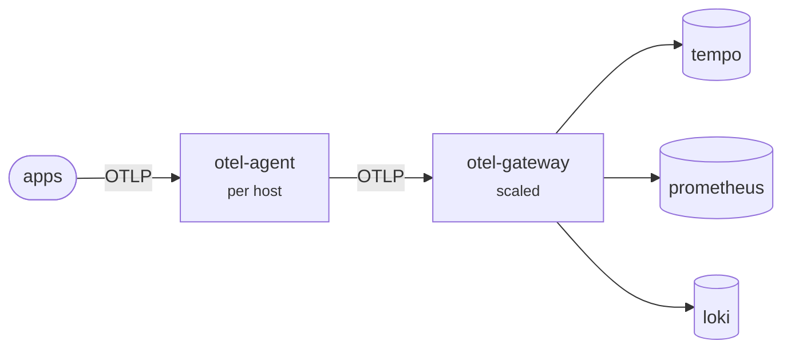

# Phase 4 — The Collector in depth

No new backend this phase. Instead the single collector becomes **two tiers**, and everything expensive moves into the second one.



Every hop speaks OTLP. That is what makes tiers composable at all — you can insert, remove or reorder a tier without anything upstream noticing.

## Why two tiers

**The agent** runs one per host (a DaemonSet in Kubernetes). It accepts telemetry over localhost, does only cheap work — host enrichment, batching — and gets out of the way. Applications talk to it and to nothing else, so an application never needs to know a backend's address, credentials, or that it changed.

**The gateway** is a scaled Deployment. Everything expensive or stateful lives here:

| | Why it cannot live in the agent |
|---|---|
| Tail sampling | Needs the **whole trace**. An agent only ever sees spans produced on its own host. |
| PII scrubbing | One reviewed config beats trusting forty teams. |
| Noise filtering | Cost governance belongs to one owner. |
| Span → metrics | Needs a consistent view to produce consistent metrics. |
| Vendor fan-out | Swap backends in one place. |

## The five component types

| | |
|---|---|
| **receivers** | how telemetry gets in — `otlp`, `prometheus`, `filelog`, `kafka` |
| **processors** | what happens in transit — `memory_limiter`, `filter`, `transform`, `tail_sampling`, `batch` |
| **exporters** | where it goes out — `otlp`, `prometheus`, `otlphttp`, `debug` |
| **connectors** | a pipeline's exporter *and* another pipeline's receiver — `span_metrics`, `forward`, `routing` |
| **extensions** | capabilities not in any pipeline — `health_check`, `pprof`, `zpages`, `file_storage` |

Get the component ID from the binary rather than from a blog post — they change:

```bash
docker run --rm otel/opentelemetry-collector-contrib:0.162.0 components
```

That is how we learned the connector is `span_metrics`, not `spanmetrics`. The collector also warned us that `otlp` is now an alias for `otlp_grpc` and `otlphttp` for `otlp_http`. Aliases still work; they will not forever.

## Processor order is semantic, not cosmetic

```yaml
processors: [memory_limiter, resource/gateway, filter/noise, transform/scrub, tail_sampling, batch]
```

**`memory_limiter` goes first.** Its job is to refuse new data when the process nears its memory ceiling, and refusing *early* is the entire point — a limiter placed after expensive processors has already paid for work it is about to discard.

**`batch` goes last.** Batching before something that drops data means assembling batches you then tear apart.

**`filter` before `transform`** — do not transform what you are about to drop.

**`tail_sampling` before `batch`** — it needs whole traces, not batch fragments.

```yaml
memory_limiter:
  check_interval: 1s
  limit_percentage: 75        # percentages, so one config fits a laptop and a 64GB node
  spike_limit_percentage: 20
```

When this fires it increments `otelcol_receiver_refused_spans`, which is why that metric being non-zero is an emergency rather than a curiosity.

## filter — cost control, and a trap that cost us an hour

Those `http send` / `http receive` ASGI spans have been visible as noise since Phase 0. They are real and useless, and a meaningful fraction of span volume:

```yaml
filter/noise:
  error_mode: ignore
  traces:
    span:
      - 'IsMatch(span.name, ".* http (send|receive)$")'
      - 'span.attributes["http.target"] == "/health"'
```

Two things to internalise.

**The filter processor DROPS what the condition MATCHES.** Everyone gets this backwards once.

**Qualify your OTTL paths.** The first version of this config used bare `name` and `attributes[...]` instead of `span.name` and `span.attributes[...]`. Combined with `error_mode: ignore`, it failed **completely silently** — the processor loaded, the pipeline ran, nothing was ever filtered, and no log line mentioned it. We only found it by querying Tempo and seeing the spans still there.

> When a filter or transform appears to do nothing, set `error_mode: propagate` temporarily. The collector will then refuse to start with a real parse error instead of shrugging.

Result after the fix, measured on a fresh window:

```text
spans named "... http send"      -> 0 traces
spans named "... http receive"   -> 0 traces
real spans (control)             -> 50 traces
custom spans (control)           -> 50 traces
```

## transform — OTTL, and scrubbing PII where it belongs

OTTL (the OpenTelemetry Transformation Language) is the modern general-purpose way to rewrite telemetry in flight. The older `attributes` and `metricstransform` processors are narrower special cases.

`orders` now deliberately attaches `customer.email` to its spans — simulating the developer who adds PII while debugging and forgets to remove it. Across enough teams and enough years, this always happens eventually, whatever the policy says. So it is stripped centrally:

```yaml
transform/scrub:
  error_mode: ignore
  trace_statements:
    - set(span.attributes["customer.email"], "[redacted]") where span.attributes["customer.email"] != nil
    - set(span.attributes["deployment.region"], "eu-west-1")
  log_statements:
    - set(log.attributes["customer.email"], "[redacted]") where log.attributes["customer.email"] != nil
```

Verified:

```text
customer.email == "[redacted]"          -> 50 traces
raw email leaked through                -> 0 traces
central enrichment applied              -> 50 traces
```

**One config protects every service — including ones written next year by people who never read the policy.** That is the argument for a gateway tier in a single sentence.

## Tail sampling — the headline feature

Head sampling (Phase 1) decides at the root span, before anything is known about how the request turned out. At 20% you keep 20% of your errors.

Tail sampling buffers complete traces for `decision_wait`, then decides with full knowledge. **Policies are OR-ed: a trace is kept if any policy matches.**

```yaml
tail_sampling:
  decision_wait: 5s          # must exceed your p99 trace duration
  num_traces: 50000
  policies:
    - name: keep-all-errors
      type: status_code
      status_code: {status_codes: [ERROR]}
    - name: keep-slow
      type: latency
      latency: {threshold_ms: 300}
    - name: keep-enterprise           # business-aware; impossible with head sampling
      type: string_attribute
      string_attribute: {key: customer.tier, values: [enterprise]}
    - name: baseline
      type: probabilistic
      probabilistic: {sampling_percentage: 20}
```

### What it actually did

Healthy system:

```text
gateway received : 105.6 spans/sec
sent to Tempo    :  16.3 spans/sec
kept             : 15.4%     storage saved: 84.6%
```

Then we set `PAYMENTS_FAILURE_RATE=0.30` and measured over 120 seconds:

```text
                      produced   in Tempo   retained
503 (errors)                92         97       ~100%
200 (successes)            461        100         22%

overall kept: 27.3%   (up from 15.4% — because errors are never dropped)
```

Successes thinned to the 20% baseline. Errors kept essentially in full. **A head sampler at 20% would have kept about 18 of those 92 errors and silently discarded 73** — before anyone knew there was an incident.

That the overall keep-rate *rises* during an incident is the signature of a healthy tail-sampling config. If your keep-rate stays flat during an outage, your policies are not matching.

### The costs, which are real

- **Memory.** The gateway buffers every in-flight trace for `decision_wait`. Budget roughly `decision_wait × trace rate × trace size`. This is what OOMs a gateway.
- **Latency.** Traces appear in Tempo `decision_wait` later than they happened.
- **`decision_wait` must exceed your p99 trace duration**, or you decide on incomplete traces and keep halves.
- **Scaling.** With more than one gateway replica, spans of one trace land on different instances and the sampler sees fragments. The fix is the `load_balancing` exporter with `routing_key: traceID` in front. Phase 7.

## span_metrics — RED for free, and a pipeline-order trap

A connector is an exporter of one pipeline and a receiver of another. `span_metrics` turns spans into `spanmetrics_calls_total` and `spanmetrics_duration_milliseconds_*`.

The SDK already emits HTTP metrics, so why bother? **Uniformity.** Every instrumented service gets identical RED metrics with identical names regardless of language, framework, or whether anyone remembered to add metrics. For a platform team governing many teams, that consistency *is* the product.

The trap is pipeline placement:

```yaml
# traces that reach Tempo: filtered, scrubbed, TAIL SAMPLED
traces/store:
  receivers: [otlp]
  processors: [memory_limiter, resource/gateway, filter/noise, transform/scrub, tail_sampling, batch]
  exporters: [otlp/tempo]

# traces that feed metrics: deliberately NOT sampled
traces/metrics:
  receivers: [otlp]
  processors: [memory_limiter, filter/noise]
  exporters: [span_metrics]

metrics/spanmetrics:
  receivers: [span_metrics]
  processors: [batch]
  exporters: [prometheus]
```

Two pipelines off the same receiver. **If `span_metrics` sat downstream of `tail_sampling`, your request rate would be the rate of *sampled* requests** — wrong by whatever the sampling ratio happens to be, and silently so. No dashboard would reveal it. Metrics must see everything; storage does not have to.

Also note `dimensions:` — every dimension is a metric label, so every dimension multiplies cardinality. `customer.tier` has 3 values. `customer.id` would have had 500. Phase 2's arithmetic applies here with full force.

## Queues, retry, and the persistent queue

```yaml
otlp/tempo:
  sending_queue:
    enabled: true
    storage: file_storage/queue     # survives a restart
    num_consumers: 4
    queue_size: 2000
  retry_on_failure:
    enabled: true
    initial_interval: 2s
    max_interval: 30s
    max_elapsed_time: 300s
```

Without `storage`, the queue lives in memory and a collector restart drops everything in flight — precisely when you can least afford it. We saw the queue work for real: during the gateway's startup failure the agent buffered, and once the gateway came up the agent's send rate (343 spans/sec) ran far above its receive rate (131/sec) while the backlog drained.

`queue_size` is a bound, not a guarantee. When it fills, data is dropped and `otelcol_exporter_enqueue_failed_*` increments.

## Extensions

| | |
|---|---|
| `health_check` on `:13133` | Liveness/readiness. Backs Kubernetes probes. |
| `zpages` on `:55679` | In-process debug pages. `/debug/tracez`, `/debug/pipelinez`. |
| `pprof` on `:1777` | Live CPU and heap profiles of the collector itself. |
| `file_storage` | Backs the persistent queue. |

```bash
curl -s localhost:13133/        # agent health
curl -s localhost:13134/        # gateway health
open http://localhost:55680/debug/pipelinez
```

## Monitoring the collector

A collector silently dropping data looks exactly like a quiet system. The **Telemetry pipeline health** dashboard is the answer, and these four numbers are the ones that matter:

```promql
sum by (tier) (rate(otelcol_receiver_refused_spans[1m]))    # pushback — data loss happening NOW
sum(rate(otelcol_exporter_send_failed_spans[1m]))           # delivery failures
max(otelcol_exporter_queue_size)                            # growing = backend slower than ingest
sum(rate(otelcol_exporter_sent_spans{exporter="otlp/tempo"}[2m]))
  / sum(rate(otelcol_receiver_accepted_spans{tier="gateway"}[2m]))   # sampling keep-rate
```

Note the `tier` label — it comes from the Prometheus scrape config, and knowing *which* tier is refusing changes what you do about it.

## Two more traps

**Distroless images plus Docker named volumes.** The collector image runs as UID 10001 and contains no shell. Docker creates named volumes root-owned, so the persistent queue failed with `permission denied` and the gateway refused to start **entirely** — one misconfigured exporter takes down the whole process, not just that exporter. Kubernetes solves this declaratively with `securityContext.fsGroup`; Compose has no equivalent, so this lab chowns in a one-shot init container.

**A failing component kills the collector.** Worth repeating: there is no partial start. Test config changes somewhere other than the thing all your telemetry flows through.

## Exercises

1. **Make the silent failure happen.** Change `span.name` back to `name` in `filter/noise`, restart the gateway, and confirm the noise spans return with no error anywhere. Then set `error_mode: propagate` and watch the collector refuse to start.
2. **Prove tail sampling adapts.** Set `PAYMENTS_FAILURE_RATE=0.3`, watch the keep-rate panel rise, then set it back and watch it fall.
3. **Break the span_metrics placement.** Move `span_metrics` into the `traces/store` pipeline after `tail_sampling` and compare `spanmetrics_calls_total` against the SDK's `http_server_duration_milliseconds_count`. The gap is your sampling ratio.
4. **Kill the gateway with the queue on.** `docker compose stop otel-gateway`, wait a minute, start it again. Watch the agent's queue grow and then drain, and confirm no traces were lost.
5. **Then kill it with the queue off.** Remove `storage:` from the agent's `sending_queue`, repeat, and count what went missing.
6. **Find what else is noise.** Use `topk(10, count by (name) (...))` or Tempo search to find the highest-volume span names, and decide which earn their keep.
